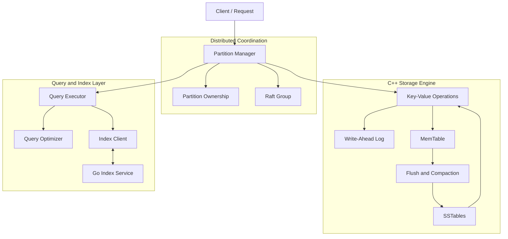
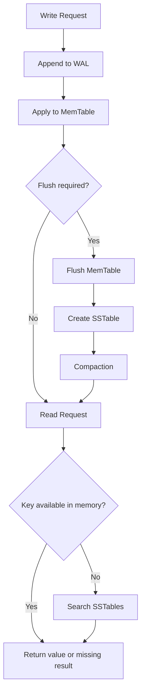

# MDDB

### A Distributed Key-Value Storage Engine

MDDB is a C++ database-engine project exploring persistent key-value storage, write-ahead logging (WAL), MemTable management, SSTable storage, compaction, query execution, indexing, and distributed coordination using Raft components.

The project brings together storage-engine fundamentals and distributed database concepts, supported by a CMake-based C++ build system and a separate Go-based index service.

**Project status:** Core implementation and test suite completed; recorded benchmark validation passed.

---

## Table of Contents

- [Overview](#overview)
- [Features](#features)
- [System Architecture](#system-architecture)
- [Storage Engine Architecture](#storage-engine-architecture)
- [Write and Read Paths](#write-and-read-paths)
- [Distributed Components](#distributed-components)
- [Query Execution and Indexing](#query-execution-and-indexing)
- [Technology Stack](#technology-stack)
- [Build and Run](#build-and-run)
- [Testing](#testing)
- [Benchmark Results](#benchmark-results)
- [Performance Analysis](#performance-analysis)
- [Project Structure](#project-structure)
- [Future Improvements](#future-improvements)

---

## Overview

MDDB is a hands-on implementation of a key-value storage engine and selected distributed database components.

The storage engine supports inserting, retrieving, updating, and deleting key-value entries. It combines in-memory state with persistent storage files and includes mechanisms for log replay, flushing, and compaction.

The project also explores partition ownership, Raft-based coordination, query optimization, scan execution, and integration with an external index service written in Go.

### Design goals

- Understand the internal mechanics of persistent key-value databases.
- Implement a storage lifecycle spanning in-memory state and disk storage.
- Explore WAL-based recovery and SSTable organization.
- Integrate query execution with index lookup.
- Implement and test components for partition ownership and Raft coordination.
- Measure storage-operation throughput and latency using repeatable workloads.

---

## Features

| Component | Description |
|---|---|
| Key-value operations | PUT, GET, UPDATE, and DELETE |
| Write-ahead log | Records write operations for persistence and recovery |
| MemTable | Maintains recently applied data in memory |
| SSTables | Stores flushed data in persistent sorted files |
| Flush mechanism | Moves in-memory data into persistent storage |
| Compaction | Consolidates SSTable data |
| Query execution | Executes predicates and scan operations |
| Query optimizer | Selects between supported execution strategies |
| Index integration | Communicates with the Go index service |
| Partition manager | Tracks partition ownership and coordinates request processing |
| Raft components | Maintains terms, roles, logs, commit indexes, and applied indexes |
| Automated testing | Exercises storage, query, index, compaction, and partition functionality |
| Benchmarking | Measures throughput, average latency, and tail latency |

---

## System Architecture

The following diagram illustrates the major logical components and their relationships.



### Architectural layers

**Request and coordination layer**

Processes requests, tracks partition ownership, and coordinates operations through the relevant Raft components.

**Storage layer**

Manages key-value operations, the write-ahead log, in-memory data, persistent SSTables, and storage maintenance.

**Query layer**

Provides query execution and optimization functionality, including scan-based execution and index integration.

**Index service**

A separate Go service exposes HTTP endpoints for index management and document-index operations. The C++ index client communicates with this service.

**Testing and benchmarking**

CMake targets and CTest provide automated validation. The benchmark executable measures the performance of selected storage workloads.

---

## Storage Engine Architecture

### 1. Write-Ahead Log (WAL)

The write-ahead log records operations before they are applied to the in-memory storage state.

Its responsibilities include:

- Recording write operations.
- Supporting recovery through log replay.
- Providing a persistence mechanism for database mutations.

The exact durability guarantees depend on the implementation's write, flush, and synchronization behavior.

### 2. MemTable

The MemTable maintains recently applied key-value state in memory.

It provides an in-memory representation of current data and acts as a source for flushing data to persistent SSTable files.

### 3. SSTables

Sorted String Tables (SSTables) store flushed data in persistent files.

When a requested key is not found in the relevant in-memory state, the storage engine can search persistent storage for the value.

### 4. Flush and compaction

Flushing moves data from the in-memory representation into persistent SSTables. Compaction consolidates SSTable data and performs storage maintenance.

These operations help manage the storage lifecycle as the database accumulates writes.

### Storage lifecycle



This is a conceptual view of the storage lifecycle; exact ordering and concurrency behavior are determined by the implementation.

---

## Write and Read Paths

### Write path

A typical write passes through request processing and the storage engine's logging and in-memory update mechanisms. Data is subsequently flushed to persistent SSTables when required.

The distributed request path can also involve Raft coordination before a command is applied.

### Read path

A read attempts to locate a key in the available in-memory state and persistent storage.

- If the key exists, its value is returned.
- If the key does not exist, the engine returns its missing-value result.
- Diagnostic messages about missing keys are not, by themselves, evidence of a correctness failure.

### Delete path

A delete removes the key from the active logical dataset. The implementation may need to preserve deletion information across persistent storage and compaction to prevent older values from reappearing.

The benchmark verifies that deleted keys return empty results and that a full scan after deletion returns zero documents.

---

## Distributed Components

MDDB includes components for partition management and Raft-based coordination.

### Partition manager

The partition manager is responsible for:

- Registering partition IDs.
- Checking partition ownership.
- Processing supported requests through a Raft group.
- Applying commands to the storage engine.
- Executing queries through the query executor.

### Raft group

The Raft group maintains state used by the coordination and replication logic, including:

- Node identity and peer IDs.
- Current term and node role.
- Raft log state.
- Commit index and last-applied index.
- Per-peer replication progress.

These components provide the foundation for exploring replicated state-machine behavior. The presence of Raft-related components should not be interpreted as proof that every distributed failure scenario or end-to-end consistency guarantee has been validated.

---

## Query Execution and Indexing

The query layer contains query execution and optimization components.

The query executor handles predicates and scan execution. The optimizer can choose among supported execution strategies, including full scans and index scans.

The Go index service is accessed through the C++ index client.

### Index service API

| Endpoint | Purpose |
|---|---|
| `GET /indexes` | List available indexes |
| `POST /indexes` | Create an index |
| `GET /indexes/{name}?value=...` | Look up entries in an index |
| `PUT /documents/{documentKey}` | Upsert a document into the index service |
| `DELETE /documents/{documentKey}` | Remove a document from the index service |

Index metadata and index entries are managed by the Go service. The query layer can use index information to support index-based execution when a suitable index is available.

---

## Technology Stack

| Technology | Role |
|---|---|
| C++ | Storage engine and core database components |
| Go | Index service |
| CMake | Build configuration |
| CTest | Automated test execution |
| WAL | Write logging and recovery support |
| MemTable | In-memory data management |
| SSTables | Persistent sorted storage |
| Raft components | Distributed coordination and log-state management |
| Mermaid | Architecture diagrams |

---

## Build and Run

The following commands use Windows Command Prompt from the project root.

### Prerequisites

- A supported C++ compiler.
- CMake.
- Go for the index service.
- Project dependencies configured in the repository.

### Configure

```cmd
cmake -S . -B build
```

### Build the Release configuration

```cmd
cmake --build build --config Release
```

### Run the test suite

```cmd
ctest --test-dir build -C Release --output-on-failure
```

### Run the benchmark

```cmd
.\build\Release\mddb_benchmark.exe
```

The benchmark creates and resets its dedicated `benchmark_data` directory on startup. Do not place unrelated data in that directory.

---

## Testing

The recorded test run completed successfully with **7 tests passed and 0 failures**.

| Test | Result |
|---|---|
| `Codec_test` | Passed |
| `compaction_test` | Passed |
| `index_client_test` | Passed |
| `partition_manager_test` | Passed |
| `query_executor_test` | Passed |
| `query_optimizer_test` | Passed |
| `scan_test` | Passed |
| **Total** | **7 passed / 7** |

To reproduce the result, run:

```cmd
ctest --test-dir build -C Release --output-on-failure
```

The table represents the recorded test run. Run the suite again after source changes before treating it as final verification.

---

## Benchmark Results

The benchmark evaluates key-value storage operations using a workload of 100,000 operations per main phase and 20 iterations per full-scan phase.

### Recorded metrics

| Workload | Operations | Throughput (ops/sec) | Average latency | P50 | P95 | P99 |
|---|---:|---:|---:|---:|---:|---:|
| GET — missing keys | 100,000 | 8,472.14 | 117.93 µs | 94.40 µs | 206.70 µs | 263.30 µs |
| UPDATE — overwrite | 100,000 | 1,425,136.85 | 0.65 µs | 0.40 µs | 0.70 µs | 1.10 µs |
| SCAN ALL | 20 | 6.87 | 145.55 ms | 145.70 ms | 150.59 ms | 153.68 ms |
| DELETE | 100,000 | 1,325,799.26 | 0.71 µs | 0.40 µs | 0.70 µs | 1.30 µs |
| SCAN ALL — after delete | 20 | 6.61 | 151.27 ms | 150.32 ms | 155.42 ms | 163.17 ms |

The benchmark also measures **PUT — INSERT** and **GET — EXISTING KEYS** and validates their results. Their numerical result blocks are not present in the excerpt available for this README, so those values must be copied from the corresponding sections of the full terminal output rather than estimated.

### Benchmark validation

The recorded benchmark run reported:

- Update validation passed.
- Delete validation passed.
- Full scans returned the expected document count.
- Scans after deleting all keys returned zero documents.
- All benchmark validation checks passed.

### Benchmark methodology

The benchmark implementation:

- Preconstructs keys and values before timed operation loops.
- Measures each operation with a steady clock.
- Calculates throughput and average latency.
- Computes P50, P95, and P99 using nearest-rank percentiles.
- Validates operation results outside the timed loops.
- Uses 100,000 operations for the main workloads and 20 iterations for full scans.

### Performance interpretation

**Update and delete**

The recorded run reports high throughput and sub-microsecond average latency for overwrite and delete operations. These are results from the measured environment, not general performance guarantees.

**Missing-key reads**

The missing-key workload deliberately reads keys that were never inserted. The engine emits diagnostic messages for these misses, and the resulting output may distort the measured throughput.

**Full scans**

The full-scan measurements are approximately 146–151 ms per scan in this run. Scan execution and persistent-data traversal are potential targets for further profiling.

**Latency percentiles**

P50 represents the median observed latency, while P95 and P99 describe higher-latency portions of the measured distribution. Full-scan latencies are in milliseconds; the other listed operation latencies are in microseconds.

### Benchmark limitations

These results are an initial baseline from one recorded run. Performance depends on the hardware, compiler configuration, filesystem, caching, background flushes, and diagnostic logging.

For more reliable comparisons, run multiple trials with the same environment and workload, and report the distribution across runs.

---

## Project Structure

The principal source areas are organized around storage, query execution, indexing, partition management, Raft, and tests.

```text
MDDB/
├── include/
│   ├── common/
│   ├── index/
│   ├── node/
│   ├── query/
│   ├── raft/
│   └── storage/
├── src/
│   ├── index/
│   ├── node/
│   ├── query/
│   ├── raft/
│   └── storage/
├── index-engine/
├── tests/
├── CMakeLists.txt
└── README.md
```

This is a high-level structural overview; verify exact file and directory names against the final repository.

---

## Future Improvements

Potential directions for further development include:

- Suppressing or sampling expected missing-key logs during performance measurements.
- Profiling and improving full-scan performance.
- Running repeated benchmark trials and recording cross-run summaries.
- Testing larger datasets and repeated flush/compaction cycles.
- Expanding crash-recovery and persistence tests.
- Exercising distributed behavior under node failures and network interruptions.
- Documenting and validating end-to-end replication and recovery guarantees.

---

## Conclusion

MDDB combines persistent key-value storage with query, indexing, partition-management, and Raft-related components.

The recorded test suite passed, and the benchmark completed all validation checks. The recorded measurements provide an initial performance baseline for overwrites, deletes, missing-key reads, and full scans.

Further profiling, repeatable benchmark trials, and additional distributed-system tests can strengthen the project's performance characterization and reliability assessment.
